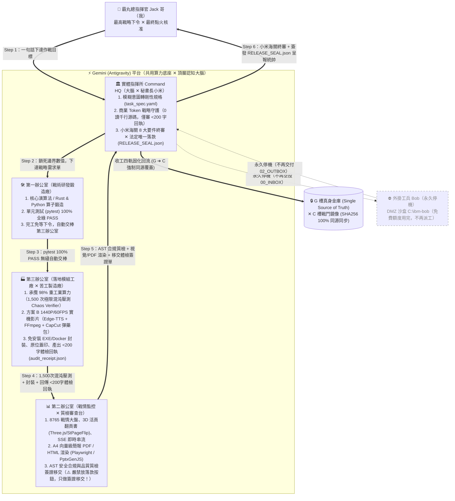

# 指揮架構流程圖與五大核心角色工作分配全域總表（command_structure_flow.md）

> 版本 v3（全域設定正式版）：確立「👑 霸丸總指揮官 Jack 哥（我） ✕ 🏛️ 實體指揮所 ✕ 📊 第二辦公室 ✕ 🏭 第三辦公室 ✕ ⚡ Gemini 平台（附：🛠️ 第一辦公室 ＆ ⛔ 外掛工兵 Bob 永久停機）」之完整工作流結構與權限邊界全域設定。

---

## 🏛️ 一、全景工作流與工作分配結構圖（Mermaid 視覺版）



---

## 📐 二、ASCII 結構全圖（終端機一眼秒懂版）

```text
                       【👑 霸丸總指揮官 Jack 哥（我）】
                     (下達作戰目標 ✕ 驗收最終全鏈路戰果)
                                      │
  ====================================▼====================================
  ║ ⚡ GEMINI (Antigravity) 共用算力底座（指揮所派工三辦子代理同平台閉環） ║
  ====================================╤====================================
                                      │
                      【🏛️ 實體指揮所 Command HQ (大腦)】
                 (戰略規格轉化 ✕ 商業 Token 守護 ✕ 法定唯一落款)
                 (👩💼 秘書長小米：海關 8 大要件安檢 ✕ 抓亂碼/防踩雷)
                                      │
              ┌───────────────────────┴───────────────────────┐
              │ Step 2: 下達戰略需求單                         │ Step 5: 移交體檢簽證單
              ▼ (task_spec.yaml 鎖死邊界)                      ▲ (audit_receipt.json <200字)
    【🛠️ 第 一 辦 公 室】                            【📊 第 二 辦 公 室】
    (戰術研發鍛造廠 / 核心工程)                      (戰情監控與全景拓撲 / 質檢台)
     - 核心演算法與狀態機鍛造                         - 8765 戰情大盤、22 場賽事即時聯動
     - 單元測試 (pytest) 100% 全綠                    - 3D 翻頁書 (Three.js) / A4 向量 PDF (Playwright)
     - 完工免等下令，自動交棒三辦！                   - AST 合規質檢簽證（嚴禁落款，只做移交！）
              │                                               ▲
              │ Step 3: 無縫自動交棒交付工件                  │ Step 4: 回傳 <200 字極簡體檢回執
              └───────────────────────► ┌─────────────────────┘
                                        ▼
                                【🏭 第 三 辦 公 室】
                          (落地模組工廠 / 無限 Token 苦工製造)
                           - 承攬 98% 重工業算力與極限混沌壓測 (1,500次 Chaos Verifier)
                           - 方案 B 1440P 演示影片 (Edge-TTS 英文旁白 + FFmpeg + 110px安全帶)
                           - CapCut 商業路演分鏡 (JSON/SRT) 彈藥包 + 免安裝 EXE/Docker 封裝
                           - 頒發及格認證 (GRADUATION_CERTIFICATE.md) 與 <200字 audit_receipt.json
  =========================================================================
                                        │
                                        ▼ Step 6: 唯一落款 RELEASE_SEAL.json
                     【🔒 G 槽真身金庫 ➔ C 槽戰鬥鏡像 100% 同源覆蓋】

  ┄┄┄┄┄┄┄┄┄┄┄┄┄┄┄┄┄┄┄┄┄┄┄┄┄┄┄┄┄┄┄┄┄┄┄┄┄┄┄┄┄┄┄┄┄┄┄┄┄┄┄┄┄┄┄┄┄┄┄┄┄┄┄┄┄┄┄┄┄┄┄┄┄
  [⛔ 外掛工兵 Bob (C:\ibm-bob)]：因免費 Token 用完，統帥 2026-10-11 裁定【永久停機】
  ┄┄┄┄┄┄┄┄┄┄┄┄┄┄┄┄┄┄┄┄┄┄┄┄┄┄┄┄┄┄┄┄┄┄┄┄┄┄┄┄┄┄┄┄┄┄┄┄┄┄┄┄┄┄┄┄┄┄┄┄┄┄┄┄┄┄┄┄┄┄┄┄┄
```

---

## 📋 三、五大核心角色工作分配與權限邊界全域總表（Global Mandate）

| 單位 / 角色 | 核心定位 | 具體負責工作分配（做什麼） | 絕對禁止紅線（不做什麼） |
| :--- | :--- | :--- | :--- |
| **1. 👑 我（霸丸總指揮官 Jack 哥）** | **帝國最高統帥**<br/>（決策與點火者） | 1. **一鍵下達目標**：用自然語言下達作戰意圖或賽事方向。<br/>2. **最終戰果驗收**：只看 100% 全綠之最終成品與交卷直達信。<br/>3. **一錘定音核准**：授權點火交卷或啟停外部單位。 | ❌ 告別繁瑣雜務、不親自改代碼、不手動盯中間測試過程（Rule 12 一三辦自動閉環）。 |
| **2. 🏛️ 實體指揮所（Command HQ ✕ 秘書長小米）** | **戰略裁決大腦**<br/>**✕ 海關安檢署**<br/>**✕ 法定唯一落款** | 1. **規格鎖死**：將哥的意圖轉為剛性規格 `task_spec.yaml`（四圖一表先行）。<br/>2. **Token 戰略保護（Rule 25）**：僅讀取三辦/二辦移交之 `< 200 字` 體檢回執（`audit_receipt.json`），將落款消耗壓在 300 Token 內。<br/>3. **小米海關把關（Rule 31~37）**：審查 8 大送審要件、清除 `ðŸ` 亂碼、驗證 GitHub Public 無痕可見、Live Demo 喚醒。<br/>4. **唯一落款與雙軌同步**：簽發 `RELEASE_SEAL.json`，收工強制執行 **G 槽真身 ➔ C 槽鏡像 ➔ 工作區 SHA256 100% 同源覆蓋**。 | ❌ **嚴禁調用 `view_file` 把幾千行原始碼讀入大腦上下文**浪費商業 Token。<br/>❌ **嚴禁在指揮所大腦內親自動手編寫繁重底層代碼或跑萬行矩陣**（Rule 49）。<br/>❌ 未通過海關全綠測試前，嚴禁放行提交。 |
| **3. 📊 第二辦公室（Second Office）** | **戰情監控大盤**<br/>**✕ 視覺/PDF 展台**<br/>**✕ 質檢審查台** | 1. **技術草案與藍圖**：擬定底層演算法架構藍圖與拓撲設計。<br/>2. **3D 筆記本 / A4 向量簡報 PDF / HTML 編輯（Rule 8 & 35）**：以 Three.js / StPageFlip 驅動 3D 翻頁書，以 Playwright / PptxGenJS 渲染國際級純英文滿版 Slides PDF（含 SVG 拓撲圖、QR Code）。<br/>3. **8765 戰情室與大盤聯動（Rule 17）**：維護 SSE 毫秒級串流、Mermaid 展台、同步 22 場賽事大盤（`phantom_grid_tournaments_data.json`）。<br/>4. **質檢簽證移交（Rule 22 & 50）**：執行 AST 語法安全合規審查，向指揮所移交體檢簽證單。 | ❌ **嚴禁放置落款按鈕、嚴禁越權簽發最終落款**（只做質檢簽證移交！）。<br/>❌ 嚴禁在架構圖或實際任務流中跳過第二辦公室（Rule 50）。 |
| **4. 🏭 第三辦公室（Third Office）** | **落地模組工廠**<br/>**✕ 旗艦影音工段**<br/>**✕ 無限苦工製造** | 1. **承攬 98% 機械重工業（Rule 22, 25, 49）**：全權承攬 Rust/C++ 底層核心編譯、**1,500 次極限混沌壓測（Chaos Verifier）** 與五維度地獄淬火（Rule 26）。<br/>2. **方案 B 1440P 技術演示影片（Rule 5, 13, 34, 38）**：Edge-TTS 專業英文旁白 + FFmpeg 1440P/60FPS 壓制（死守 2~3 分鐘黃金時長、38pt 粗體大字、底部 110~135px Title Safe Area 避雷帶、四邊閉合終端框）。<br/>3. **CapCut 商業路演工段（Rule 9）**：透過 `capcut_bridge.py` 產出分鏡 JSON 與動態 SRT 字幕彈藥包。<br/>4. **封裝與體檢回執**：封裝免安裝 EXE/Docker、原位注入 Header、頒發 `GRADUATION_CERTIFICATE.md` 與 `< 200 字` `audit_receipt.json`。 | ❌ 嚴禁未經混沌淬火就宣告完工。<br/>❌ 嚴禁回傳大段冗長日誌或原始碼倒灌污染指揮所 Context。<br/>❌ 嚴禁將過渡編譯快取留在沙盒或污染桌面（恪守 Zero-Desktop）。 |
| **5. ⚡ Gemini 平台（Antigravity）** | **共用算力底座**<br/>**✕ 陸空協同中樞** | 1. **共用算力底座（2026-10-11 統帥裁定）**：是指揮所與一、二、三辦公室**共用的運作平台**，並非額外獨立大腦。<br/>2. **四大動腦時機（Rule 27）**：① 模糊語意轉剛性幾何/物理規格；② 四圖一表先行鎖死數值；③ 異常自癒與 Root-Cause 診斷；④ 開工秒讀狀態檔找回記憶。<br/>3. **子代理分流執行**：繁重工作（編譯、壓測、打包、批次產出）由指揮所派給三辦子代理在同一平台背景執行，僅回報 `< 200 字` 體檢回執。 | ❌ **三大禁止邊界（Rule 27）**：<br/>1. 嚴禁讓大腦硬算百億次浮點矩陣（交本地 GPU）；<br/>2. 嚴禁高頻毫秒級輪詢（交二辦本地監控）；<br/>3. 嚴禁把千行源碼塞爆主對話 Context。 |
| **（附）🛠️ 第一辦公室 ＆ ⛔ Bob** | **一辦：核心鍛造**<br/>**Bob：永久停機** | - **第一辦公室**：專注核心演算法、單元測試（`pytest`）100% 全綠 PASS，完工**免等統帥下令，全自動交棒第三辦公室**（Rule 12）。<br/>- **外掛工兵 Bob**：因免費 Token 用完，統帥於 2026-10-11 親口裁定**永久停機**，常態一律採「三辦公室鼎足自立閉環」。 | ❌ 任何 Agent 嚴禁擅自啟用 Bob 或空投 `00_INBOX/`（除非 Bob 重獲免費額度且統帥親口下令）。 |

---

## v1 原版 ASCII 圖（歷史留存備查）

```text
                     【👑 霸丸總指揮官 Jack 哥】
                                  │
                  【實體指揮所 Command HQ (大腦)】
             (戰略指針裁決 ✕ 商業 Token 守護 ✕ 唯一落款)
                                  │
          ┌───────────────────────┴───────────────────────┐
          │ (下達戰略需求單)                               │ (移交體檢簽證單)
          ▼                                               ▲
【第 一 辦 公 室】                                  【第 二 辦 公 室】
(戰術研發鍛造廠 / 沙盒工兵)                        (戰情監控與質檢審查台)
   - 核心演算法與 Rust 算子                           - 8765 Web 大盤與 3D 拓撲展台
   - BTreeMap 微秒撮合引擎                            - 四合一旗艦戰情儀實體動態映照
   - 多跳躍套利路由 (Graph)                          - AST 安全合規與品質質檢簽證
   - 單元測試 100% 全綠 PASS                          - 嚴禁放落款按鈕，只做簽證移交！
          │                                               ▲
          │ (無縫交棒交付工件)                              │ (回傳極簡驗收體檢單)
          └───────────────────────► ┌─────────────────────┘
                                    ▼
                            【第 三 辦 公 室】
                      (落地模組工廠 / 無限 Token 苦工製造)
                         - 1,500 次極限混沌壓測 (Chaos Verifier)
                         - 本地編譯 DLL / 二進位權重封裝
                         - 方案 B 1440P 全景影片流水線
                         - 產出小於 200 字極簡體檢回執 (Audit Receipt)
```
